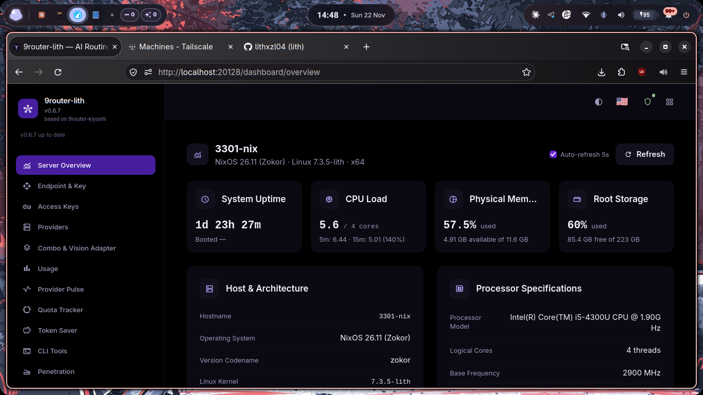

<div align="center">
  

  # 9router-lith

  **Production-grade AI gateway & routing proxy for coding agents (Cline, OpenCode, Codex, Claude Code)** — a customized edition based on **[9Router-Kiyoshi](https://github.com/rifqi1146/9router-kiyoshi/)**, **[9Router Plinian](https://github.com/Azhar457/9router)** (by Azhar457), & **[9Router](https://github.com/decolua/9router)** (by decolua), featuring 7-Layer Anti-Ban Armor from **[OmniRoute](https://github.com/cheaper-inference/OmniRoute)**, Live Provider Pulse observability, and a cohesive purple-inspired AMOLED design system.

  [](./CHANGELOG.md)
  [](./LICENSE)

  [⬇️ Install](#-installation) • [🍴 What's in This Edition](#-whats-in-this-edition) • [🛡️ 7-Layer Anti-Ban](#-antigravity-anti-ban-armor) • [📊 Live Provider Pulse](#-live-provider-pulse-telemetry) • [🙏 Acknowledgments](#-acknowledgments)

</div>

---

## 🔀 Lineage & About This Fork

This repository is **9router-lith**, a customized production edition built on top of:
1. **[9Router-Kiyoshi](https://github.com/rifqi1146/9router-kiyoshi/)** (`rifqi1146/9router-kiyoshi`, v0.6.7) — which introduced Live Provider Pulse telemetry, Stream Passthrough Sentinel Finalize, Native Antigravity SSE-to-JSON, Server Overview Dashboard, and Access Key Injection switches.
2. **[9Router Plinian](https://github.com/Azhar457/9router)** (`Azhar457/9router`, v0.6.7) — which introduced the Go entry proxy, Red Team Toolkit, external payload registry, and custom payload trees. This fork keeps the Go entry proxy and drops the Red Team Toolkit, payload and developer dashboard surfaces.
3. **[9Router](https://github.com/decolua/9router)** (`decolua/9router`) — the original project providing the multi-provider routing engine, translator core, combo fallback, and Next.js dashboard.
4. **[OmniRoute](https://github.com/cheaper-inference/OmniRoute)** (`cheaper-inference/OmniRoute`) — source of the multi-layer Antigravity header scrubbing, 429 guard, family-level cooldown, and pacing patches.

### Why This Fork Exists
Heavy coding-agent workloads (e.g. Cline, OpenCode, Codex) frequently send massive prompts (**100k–380k prompt tokens per turn**). Under these real-world conditions, standard gateways hit subtle failures:
- **Premature socket closes**: Strict clients (such as OpenCode or `@ai-sdk`) terminate TCP connections immediately upon receiving `data: [DONE]`, causing standard W3C streams to fire `cancel()` instead of `flush()`, resulting in unfinalized streams, missing console summaries, and 0-token usage logs.
- **Upstream bans and prompt cache misses**: Random project ID generation and leaking Chromium/Stainless headers trigger Google Cloud / Antigravity abuse flags and invalidate prompt caches.
- **Silent non-streaming failures**: Upstream Gemini endpoints emit SSE payloads that fail non-streaming JSON parsers, returning empty strings or 502 Bad Gateway responses.
- **Observability blindness**: Lack of real-time latency percentiles (TTFT p50 vs p95), error code distribution, and per-account health tracking.

**9router-lith** inherits Kiyoshi's fixes for each of these production issues while preserving 100% upstream compatibility.

---

## 🍴 What's in This Edition

| Feature / Mod | What it does | Origin |
| --- | --- | --- |
| 📊 **Live Provider Pulse (`/dashboard/pulse`)** | Real-time telemetry: sample window (50/100/200/500), TTFT p50/p95, total roundtrip duration, cache-hit %, HTTP status distribution (`200`, `400`, `401`, `5xx`), and recent error decoder with browser-local timestamps (WIB). | **Kiyoshi** |
| 🛡️ **7-Layer Antigravity Armor** | Complete anti-ban protection for Antigravity & Google Cloud: scrubs 24 proxy/Chromium headers, local 429 refusal guard, 24h quota exhaustion cooldown, family-isolated lockout, 1200ms jittered pacing, authentic `aicode-consumers` project ID preservation, and 5m quota polling. | **OmniRoute** (ported & adapted) |
| ⚡ **Stream Passthrough Sentinel Finalize** | Detects `data: [DONE]` directly inside the passthrough transform loop and invokes `finalizeStream()` immediately — guarantees usage accounting and console logs even when strict clients abort on EOF. | **Kiyoshi** |
| 🔄 **Native Antigravity SSE-to-JSON** | `parseSSEToOpenAIResponse()` decodes native Gemini `{response:{candidates:[...]}}` SSE frames for non-streaming requests. Fixes empty `""` content and 502 errors. | **Kiyoshi** |
| 🖥️ **Server Overview Dashboard (`/dashboard/overview`)** | Sidebar system monitor showing CPU/RAM/Disk, 1/5/15m load averages, thermals, listening ports, network interfaces, Tailscale/Cloudflare status, and uptime. | **Kiyoshi** |
| 🔑 **Access Keys Injection Switch & Quotas** | Master ON/OFF toggle per API key to selectively bypass system prompt steering/jailbreaks, plus daily/lifetime token quotas and key expiry. | **Kiyoshi** |
| 🎨 **Purple AMOLED Design System** | True AMOLED black (`#000000`) dark theme with a purple primary (`#7C3AED` dark / `#461E9E` light), plus an English-only UI. Built on Kiyoshi's solid-token design system with zero generic translucent AI styling. | **lith** (on Kiyoshi's base) |
| 🤝 **CodeBuddy & WorkBuddy Identity** | Passes through user/developer prompts without Tencent static identity overrides, adds UUIDv7 conversation header family, and provides fallback prompts for headless requests. | **Kiyoshi** |
| ⚡ **Go Entry Proxy** | Public port handled by a Go reverse proxy (client-IP stamping, TTFB logging, RTK sidecar). | **Plinian** |

---

## 🛡️ Antigravity Anti-Ban Armor

Ported and adapted from **[OmniRoute](https://github.com/cheaper-inference/OmniRoute)**, this 7-layer defense system shields Antigravity connections from automated bans and quota traps:

1. **Layer 1 — Header Scrubbing**: Strips 24 leaking headers (`x-forwarded-for`, `sec-ch-ua`, `sec-ch-ua-platform`, `sec-fetch-*`, Stainless SDK signatures) before sending to upstream Google endpoints.
2. **Layer 2 — 429 Refusal Guard**: Caches prompts that trigger refusal 429s locally for 2–30 minutes, preventing agent hammer-loops from torching account reputation.
3. **Layer 3 — 429 Engine & Cooldown**: Differentiates temporary rate limits from 24h quota exhaustions; triggers automated 24h cooldown to prevent repeated retries against exhausted accounts.
4. **Layer 4 — Family-Level Lockout**: Isolates quota locks per model family (`gemini`, `claude`, `argon`). A Gemini quota exhaustion does not lock Claude models on the same account.
5. **Layer 5 — Jittered Account Pacing**: Enforces a 1200ms ±30% jitter pacing per account to eliminate parallel request bursts.
6. **Layer 6 — Authentic Project ID Preservation**: Always preserves the legitimate `aicode-consumers` project ID returned by `loadCodeAssist`. Eliminates random project generation that fragmented Google prompt caching and triggered bot detection.
7. **Layer 7 — Quota Polling Throttling**: Reduces background quota polling from 30 seconds to 5 minutes per account, cutting automated polling traffic by 10×.

---

## 📊 Live Provider Pulse Telemetry

Accessible directly from the sidebar navigation at `/dashboard/pulse`:

- **Sample Window**: Toggle between the last 50, 100, 200, or 500 requests on the fly.
- **Overall Health**: Dynamically classified based strictly on global success rate:
  - 🟢 **Healthy**: $\ge 90\%$ success rate.
  - 🟡 **Degraded**: $70\%$ to $<90\%$ success rate.
  - 🔴 **Down**: $<70\%$ success rate.
  *(Latency is prominently reported but never unfairly downgrades a provider, since large-context agent loops of 100k–380k tokens legitimately require 6–8s TTFT).*
- **Multi-Dimensional Breakdowns**:
  - **Per Provider**: Request counts, success rate, TTFT p50/p95, total duration p50, cache hit %, input/output tokens, and localized last seen time.
  - **Per Model**: Track performance across individual models (e.g. `gemini-3.8-flash-high` vs `deepseek-v4.1-flash`).
  - **Per Account / Key**: Uses SQLite `LEFT JOIN providerConnections` to map internal connection IDs to actual account names and emails (e.g. `Account 6`, `user@example.com`).
- **HTTP Status Distribution**: Visual chip breakdown of response codes (`200 OK`, `400 Bad Request`, `401 Unauthorized`, `500 Upstream Error`, `unknown`).
- **Recent Failures Decoder**: Displays recent upstream errors with HTTP status codes and truncated error previews (e.g. invalid thinking level, upstream provider timeout).
- **Latency Sparkline Chart**: Area chart visualizing median (p50) versus tail (p95) TTFT using Recharts with the dashboard's theme tokens.

---

## ⬇️ Installation

### Prerequisites
- **Node.js**:
  - **Runtime**: Node.js $\ge 22.5$ (Node 24 recommended) to activate the native C++ `node:sqlite` driver.
  - **Build**: Node.js 20 recommended for compiling Next.js 16 without SWC bus errors.
- **Git**

### Step 1 — Clone Repository
```bash
git clone https://github.com/lithxzl04/9router-lith.git
cd 9router-lith
```

### Step 2 — Environment Configuration
```bash
cp .env.example .env
```
*(Optional) Modify `.env` to configure port, hostname, or override `INITIAL_PASSWORD` (default: `123456`) and `JWT_SECRET`.*

### Step 3 — Install Dependencies & Build
```bash
# Install dependencies
npm install

# Build Next.js dashboard
npm run build

# Build CLI package
npm run cli:pack
```

### Step 4 — Start the Server

**Option A: Run via npm (Recommended for Servers / VPS)**
```bash
PORT=20128 HOSTNAME=0.0.0.0 NEXT_PUBLIC_BASE_URL=http://localhost:20128 npm run start
```

**Option B: Install as Global CLI Launcher**
```bash
cd cli
npm install -g .

# Launch background daemon
9router-lith -p 20128 --host 0.0.0.0 --skip-update --no-browser
```

Common CLI flags:
```bash
9router-lith --port 20128     # port (default: 20128)
9router-lith --host 0.0.0.0   # bind address
9router-lith --no-browser     # disable opening browser automatically
9router-lith --skip-update    # bypass startup version check
```

The dashboard will be accessible at:
👉 **http://localhost:20128/dashboard** (Default login password: `123456`)

---

## 🔄 Request Lifecycle & Architecture

```
Cline / OpenCode / Codex / Claude Code
        │  POST http://localhost:20128/v1/chat/completions
        ↓
┌────────────────────────────────────────────────────────┐
│ 9router-lith (Go Reverse Proxy + Next.js Server)       │
│  • Custom Server: socket IP extraction & cf-ip trust   │
│  • RTK Pre-Translate Token Saver (cursor tool_results) │
│  • Translator Engine (OpenAI ↔ Claude ↔ Gemini ↔ ...)  │
│  • 7-Layer Antigravity Armor & Header Scrubbing        │
│  • Combo Fallback & Round-Robin Load Balancer          │
│  • Zero-Drop Stream Passthrough Sentinel Finalizer     │
│  • RequestDetails & Live Telemetry Storage (SQLite)    │
└───────┬────────────────────────────────────────────────┘
        │
        ├─► Antigravity (Google Cloud / Gemini 3.8)
        ├─► CodeBuddy (DeepSeek v4.1 / Qwen 3.5)
        ├─► Kiro / Claude 4.5 Sonnet
        └─► OpenCode Free / Vertex AI / Custom Endpoints
```

Full architecture specifications: [`docs/ARCHITECTURE.md`](./docs/ARCHITECTURE.md).

---

## 💾 Data & Persistence

State is persisted to SQLite (`src/lib/db/`) with a fallback adapter chain (`driver.js`):
`bun:sqlite` → `better-sqlite3` → `node:sqlite` (Node $\ge 22.5$, default) → `sql.js` (pure JS fallback).

| Platform | Default Path |
| --- | --- |
| Linux / macOS | `~/.9router/db/data.sqlite` |
| Windows | `%APPDATA%\9router\db\data.sqlite` |
| Custom | Set `DATA_DIR` environment variable |

Security-relevant environment variables (see `.env.example`):
- `JWT_SECRET`: Dashboard session cookie signing secret.
- `INITIAL_PASSWORD`: Initial dashboard login password (default `123456` — **override immediately**).
- `API_KEY_SECRET`: Encryption key for provider credentials.
- `MACHINE_ID_SALT`: Salt for machine ID fingerprinting.

---

## 📖 Documentation

- **Fork install & build:** [`FORK-INSTALL.md`](./FORK-INSTALL.md) — packaging the `9router-lith` CLI and installing it.
- **Changelog:** [`CHANGELOG.md`](./CHANGELOG.md) — version history and release notes.
- **Full Architecture:** [`docs/ARCHITECTURE.md`](./docs/ARCHITECTURE.md)
- **Engine Rules:** [`open-sse/AGENTS.md`](./open-sse/AGENTS.md)

---

## 🙏 Acknowledgments

9router-lith stands on the work of:

- **[9Router-Kiyoshi](https://github.com/rifqi1146/9router-kiyoshi/)** — the immediate upstream foundation providing Live Provider Pulse, stream sentinel finalization, and Antigravity integration.
- **[Azhar457](https://github.com/Azhar457)** and **[9Router Plinian](https://github.com/Azhar457/9router)** — the upstream fork providing the Go entry proxy (its Red Team Toolkit and payload surfaces are not carried into this fork).
- **[OmniRoute](https://github.com/cheaper-inference/OmniRoute)** — creators of the 7-layer Antigravity anti-ban defense system, header scrubbing, and jittered pacing architecture.
- **[decolua](https://github.com/decolua)** and all contributors to **[9Router](https://github.com/decolua/9router)** — the original foundational AI routing gateway project.
- **[CLIProxyAPI](https://github.com/1rgs/CLIProxyAPI)** — original Go implementation that inspired 9Router.
- **[RTK](https://github.com/rtk-ai/rtk)**, **[Headroom](https://github.com/chopratejas/headroom)**, **[Caveman](https://github.com/JuliusBrussee/caveman)**, and **[Ponytail](https://github.com/DietrichGebert/ponytail)** — token-saving compression utilities.

---

## 📄 License

MIT — see [LICENSE](./LICENSE).
